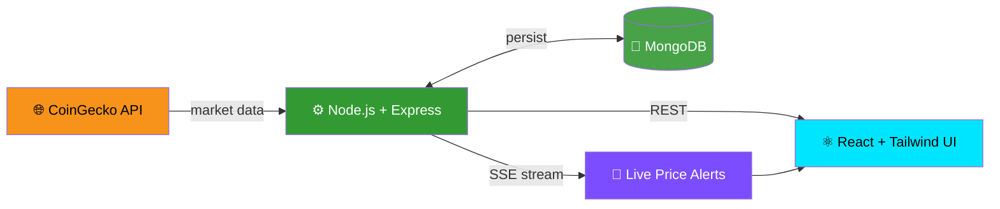

<div align="center">


<br/>


[](https://www.linkedin.com/in/arpit-tiwari-3b66472b1/)
[](https://www.youtube.com/channel/UCzp0hvCl89_dj9GvvBREBFQ)
[](https://x.com/ArpitTi59178439)
[](https://arpittiwari.lovable.app)
[](https://karocryptotrack.lovable.app)
[](mailto:arpittiwari12006@gmail.com)


</div>

## 🧬 `whoami`

```ts
const arpit = {
  name:         "Arpit Tiwari",
  role:         "Full-Stack Engineer",
  base:         "Khanna, Punjab, India 🇮🇳",
  education:    "B.Tech CSE · Chandigarh Group of Colleges · 2022–2026",
  stack:        ["React", "TypeScript", "Node.js", "Express", "MongoDB", "Tailwind"],
  obsessedWith: ["real-time data", "clean architecture", "blockchain", "cryptography"],
  shipping:     "KaroCryptoTrack — live crypto intelligence platform",
  mantra:       "Ship fast. Measure honestly. Iterate relentlessly.",
  openTo:       ["internships", "full-time SDE / full-stack roles", "Web3 & fintech collabs"],
};
```

> **I build products where live market data meets interfaces people trust** — on the MERN stack, with React + TypeScript frontends and a first-principles grasp of the cryptography beneath Web3.

<br/>

## 🔥 Flagship — [KaroCryptoTrack](https://karocryptotrack.lovable.app)

<div align="center">

[](https://karocryptotrack.lovable.app)

</div>

**A full-stack cryptocurrency information and price-tracking SaaS** delivering live market data and push-based price alerts.



<table>
<tr>
<td width="33%" align="center">

### 📡 Real-Time
CoinGecko-powered live prices

</td>
<td width="33%" align="center">

### 🔔 Push Alerts
Server-Sent Events delivery, no polling

</td>
<td width="33%" align="center">

### 🧱 Full MERN
React · Express · Node · MongoDB

</td>
</tr>
</table>

<br/>

## 🪐 Tech Universe

<div align="center">


<br/>


</div>

<details>
<summary><b>🔬 Deep-dive: areas of expertise (click to expand)</b></summary>
<br/>

| ⛓️ Blockchain & Web3 | 🔐 Security & Crypto | 🤖 AI & Algorithms | 🌐 Engineering |
|:--|:--|:--|:--|
| Public vs. private chains | SHA-256 & hashing applications | Rational agents, PEAS | MERN architecture |
| Digital identity, land records | Cipher fundamentals | State-space search | Real-time SSE pipelines |
| Public distribution systems | ZKPs, post-quantum crypto | MDPs, Bellman equations | React + TypeScript UIs |
| Finance · healthcare · supply chain | WPA2/WPA3, 802.1X | Value & policy iteration | REST API design |

</details>

<br/>

## 📊 GitHub Command Center

<div align="center">


</div>

<br/>

## 🎥 Build in Public

<div align="center">

| | Channel | Focus |
|:--:|:--|:--|
|  | [**Subscribe →**](https://www.youtube.com/channel/UCzp0hvCl89_dj9GvvBREBFQ) | Project walkthroughs · dev learnings · demos |
|  | [**Follow →**](https://x.com/ArpitTi59178439) | Build logs · crypto-tech takes |
|  | [**Connect →**](https://www.linkedin.com/in/arpit-tiwari-3b66472b1/) | Launches · career milestones |

</div>

<br/>

## 🚀 Featured Projects

<table>
<tr>
<td width="50%" valign="top">

#### 🪙 KaroCryptoTrack
Live crypto tracker with an SSE alert engine on the MERN stack.

`React` `Tailwind` `Node.js` `Express` `MongoDB` `CoinGecko`

[**🔗 Live**](https://karocryptotrack.lovable.app) · [**💻 GitHub**](https://github.com/Arpittiwari12006)

</td>
<td width="50%" valign="top">

#### 🌐 Developer Portfolio
Personal brand site showcasing projects, skills, and engineering approach.

`React` `TypeScript` `Tailwind`

[**🔗 Live**](https://arpittiwari.lovable.app) · [**💻 GitHub**](https://github.com/Arpittiwari12006)

</td>
</tr>
<tr>
<td colspan="2">

#### ⛓️ Blockchain Applied Research
Case studies across **finance · healthcare · supply chain · education · government · digital identity**, plus SHA-256 implementations and cryptographic fundamentals.

`Blockchain` `SHA-256` `Cryptography` `ZKPs`

</td>
</tr>
</table>

<br/>

## 🎓 Education

<div align="center">

| 🏫 Institution | 🎯 Degree | 📅 Batch |
|:--:|:--:|:--:|
| Chandigarh Group of Colleges, Jhanjheri<br/><sub>Affiliated to I.K. Gujral Punjab Technical University</sub> | B.Tech, Computer Science & Engineering | 2022 – 2026 |

</div>

<br/>

<div align="center">


## 🤝 Let's Build Something Remarkable

### 💼 Internships &nbsp;·&nbsp; 🚀 Full-Stack / SDE Roles &nbsp;·&nbsp; ⛓️ Web3 & Fintech Collabs &nbsp;·&nbsp; 🛠️ Open Source

[](mailto:arpittiwari12006@gmail.com)
[](https://www.linkedin.com/in/arpit-tiwari-3b66472b1/)


</div>
